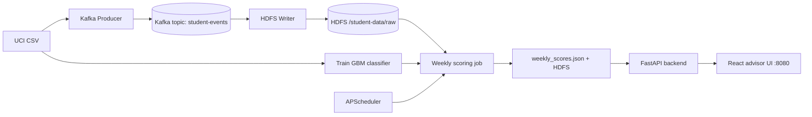

# Student Performance & Dropout Risk Prediction

End-to-end miniproject pipeline for **early dropout intervention**: ingest attendance, assignment, and assessment events through **Kafka**, land them on **HDFS**, train a **classification model** on the UCI [*Predict Students' Dropout and Academic Success*](https://archive.ics.uci.edu/dataset/697/predict+students+dropout+and+academic+success) dataset (plus stream engagement features), compute **weekly risk scores**, and surface flagged students on a **React advisor dashboard** (risk **> 0.6**).

## Architecture



**Stack:** Kafka, Hadoop HDFS (Docker), scikit-learn, FastAPI, React (Vite), APScheduler.

## Quick start (Windows)

Use a **venv** so `kafka-python` is not confused with the unrelated PyPI `kafka` package:

```powershell
cd C:\Users\thanu\student-dropout-risk-pipeline
python -m venv .venv
.\.venv\Scripts\Activate.ps1
pip install -r requirements.txt

# Full stack: Docker + Kafka ingest + train + score + React build
# Start Docker Desktop first
.\scripts\run_all.ps1 -WithDocker

python dashboard/app.py
# http://localhost:8080
```

Without Docker (UCI stream simulation + ML + UI):

```powershell
.\scripts\run_all.ps1 -SkipProducer
python dashboard/app.py
```

### Frontend development

```powershell
# Terminal 1
python dashboard/app.py

# Terminal 2
cd frontend
npm install
npm run dev
# http://localhost:5173  (API proxied to :8080)
```

## Manual steps

```powershell
python scripts/download_dataset.py
docker compose up -d
python pipeline/kafka_producer.py --weeks 52 --limit-students 500 --delay 0
python pipeline/kafka_to_hdfs_consumer.py --max-messages 50000
python ml/train_model.py
python ml/weekly_scoring.py
cd frontend && npm install && npm run build
python dashboard/app.py
```

## Configuration

Copy `.env.example` to `.env`:

| Variable | Default | Purpose |
|----------|---------|---------|
| `KAFKA_BOOTSTRAP` | `localhost:29092` | Kafka broker |
| `HDFS_NAMENODE_HOST` | `localhost` | WebHDFS |
| `RISK_THRESHOLD` | `0.6` | Advisor flag cutoff |
| `WEEKLY_SCHEDULER_ENABLED` | `true` | APScheduler in API process |
| `SCORING_INTERVAL_MINUTES` | `0` | If >0, score every N minutes (demo); else weekly cron |
| `SCORING_CRON_DAY` / `SCORING_CRON_HOUR` | `mon` / `6` | Weekly scoring (UTC) |

If HDFS is down, the consumer/scoring jobs **mirror** data under `storage/hdfs_mirror/`.

## Project layout

```
pipeline/     Kafka producer, HDFS consumer, WebHDFS client
ml/           Features, training, weekly scoring
jobs/         APScheduler weekly scoring
dashboard/    FastAPI REST API
frontend/     React advisor UI (Vite)
docs/         PROJECT_REPORT.md for submission/viva
docker-compose.yml   Zookeeper, Kafka, NameNode, DataNode
```

## REST API

- `GET /api/health` — service + scheduler status
- `GET /api/scores` — all students, latest weekly run
- `GET /api/flagged` — students with `dropout_risk_score >= 0.6`
- `POST /api/scores/refresh` — run scoring job on demand

## Model

- **Algorithm:** `GradientBoostingClassifier` (scikit-learn)
- **Target:** `Target == Dropout` (binary)
- **Features:** UCI attributes + stream metrics (attendance, assignments, assessments)
- **Output:** `dropout_risk_score` = P(dropout)

## Ports

| Service | Port |
|---------|------|
| Kafka (host) | 29092 |
| HDFS NameNode UI | 9870 |
| Advisor platform (API + built UI) | 8080 |
| Vite dev server | 5173 |

See **docs/PROJECT_REPORT.md** for requirement mapping and viva notes.
